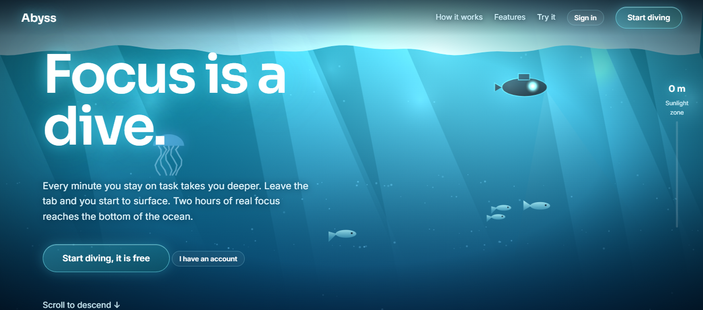
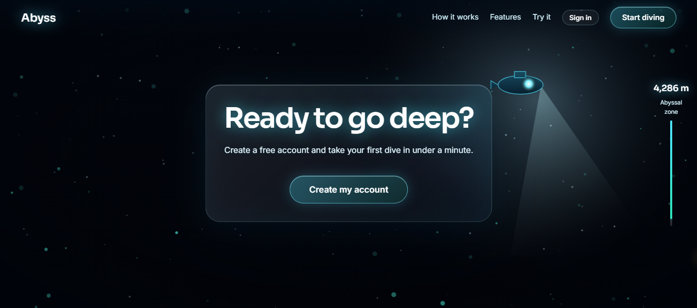
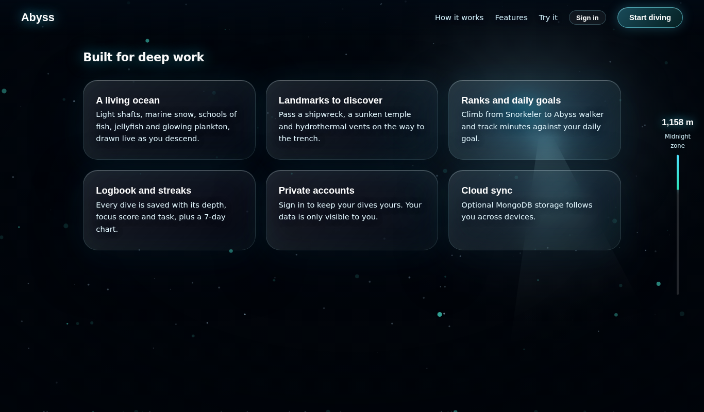
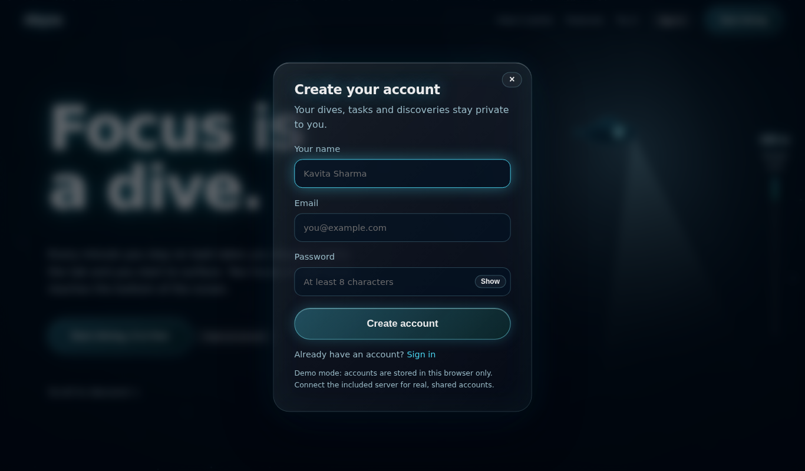
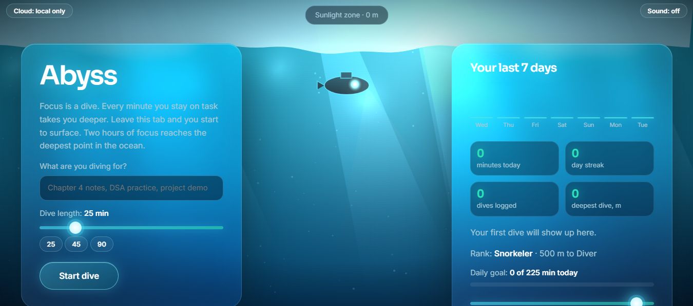
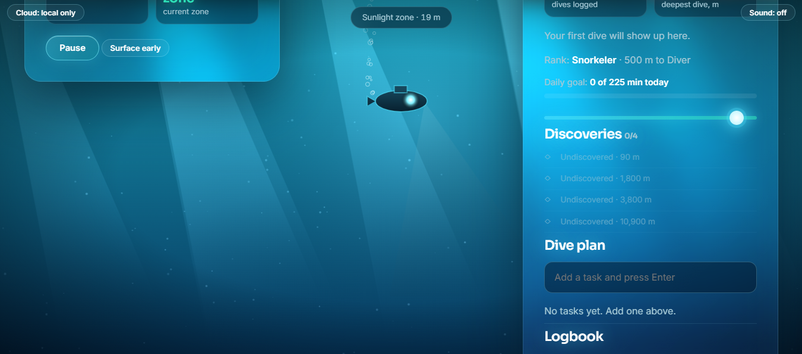

# Abyss: a focus dive

**Focus is a dive.** Every minute you stay on task takes you deeper, from the sunlit surface to the bottom of the Mariana Trench. Leave the tab and you start to surface. Two hours of real focus reaches the deepest point in the ocean.



## Contents
[Screenshots](#screenshots) · [Features](#features) · [Quick start](#quick-start) · [Enable accounts and MongoDB](#enable-real-accounts-and-mongodb) · [How to use it](#how-to-use-it) · [Security](#security) · [API](#api) · [Deploy](#deploy) · [Project structure](#project-structure) · [Troubleshooting](#troubleshooting) · [License](#license)

## Screenshots

| Landing page: scroll to descend | Ready to go deep? |
|---|---|
|  |  |

| Landing features | Sign up |
|---|---|
|  |  |

| Start a dive | A dive in progress |
|---|---|
|  |  |

## Features

**Focus tool**
- Pick a task and a length from 5 to 120 minutes. Depth, pressure and temperature update live.
- Leaving the tab pauses your descent: time away does not count, and your focus score reflects it.
- Pause with the button or the Space key, surface early, and take a one-minute guided breathing break after every dive.
- Weekly chart, day streak, daily goal, task list, copyable logbook and optional ocean sound.

**A living ocean, drawn live on canvas**
- Waves and sun glare at the surface, light shafts, marine snow that streams past as you descend, bubbles, fish schools, jellyfish, anglerfish and glowing plankton in the deep.
- Landmarks that rise to meet you: the **SS Meridian wreck** (90 m), a **sunken temple** (1,800 m), **hydrothermal vents** (3,800 m) and the **Challenger Deep** seabed (10,900 m).

**Progression**
- Unlock each landmark once as a discovery, and climb ranks from Snorkeler to Abyss walker.

**Accounts and data**
- Interactive landing page: scrolling descends through the ocean, with a depth gauge and a "how deep would you get?" calculator.
- Sign up and sign in. Every account's dives, tasks, discoveries and goal are private to that account.
- Optional MongoDB cloud sync through the included API.

## Quick start

No build step and no dependencies. Open `index.html` in a browser, or serve the folder:

```bash
npx serve .        # then open the printed address
```

In this mode (called demo mode) accounts and dives live in your browser's local storage. Passwords are stored as salted PBKDF2 hashes, and each account only sees its own data. Clearing site data removes them.

## Enable real accounts and MongoDB

Use the included API when you want accounts that work across devices.

1. **Create a database.** On [MongoDB Atlas](https://www.mongodb.com/atlas), create a free cluster, add a database user (Database Access), and allow your IP under Network Access (use `0.0.0.0/0` for a hosted server).
2. **Configure the server.**
   ```bash
   cd server
   cp .env.example .env
   ```
   Edit `.env`:

   | Variable | Meaning |
   |---|---|
   | `MONGODB_URI` | Your Atlas connection string (replace `USER` and `PASSWORD`; percent-encode special characters) |
   | `MONGODB_DB` | Database name, default `abyss` |
   | `JWT_SECRET` | Long random secret that signs login tokens. Generate one: `node -e "console.log(require('crypto').randomBytes(48).toString('hex'))"` |
   | `CLIENT_ORIGIN` | Address where the page is hosted, comma separated. Use `*` only while testing |
   | `PORT` | Default `5060` |
3. **Start it.**
   ```bash
   npm install
   npm start          # http://localhost:5060
   ```
4. **Open the page with the API address:** `index.html?api=http://localhost:5060`. You can also set `window.ABYSS_API = "https://your-api"` near the top of the script in `index.html`. The top-left chip changes to **Cloud: synced** and the sign-up form now creates real server accounts.

## How to use it

1. **Open the page.** Scroll to descend through the ocean, try the depth calculator, then press **Start diving**.
2. **Create an account** (name, email, password of at least 8 characters) or sign in.
3. **Start a dive.** Type what you are diving for, choose a length (or a 25 / 45 / 90 preset) and press **Start dive**. Turn on **Sound** for ambient ocean audio.
4. **Stay on task.** Watch your depth, pressure and zone. Each new zone shows a short fact. Switching tabs surfaces you and that time is not counted.
5. **Surface.** Finish the timer, or press **Surface early** (dives under one minute are not logged). You get your depth, focus score and a breathing break.
6. **Track progress.** The side panel shows your last 7 days, streak, rank, daily goal, discoveries, task list and logbook. Use **Dive** next to a task to load it, and **Copy logbook** to export.
7. **Sign out** with the button at the top, or delete your stored data from **Account**.

Depth model: focus time maps linearly to depth, so 2 hours of focus equals 10,935 m (the Mariana Trench). Zones: Sunlight (0 m), Twilight (200 m), Midnight (1,000 m), Abyssal (4,000 m), Hadal (6,000 m).

## Security

- **Authentication:** email and password. The server hashes passwords with scrypt and a random salt, and signs login tokens (HS256 JWT, 7 days) sent as `Authorization: Bearer <token>`. Login and sign-up attempts are rate limited.
- **Authorization:** every data route requires a valid token and only reads or writes records owned by the signed-in user. Nothing in the API lets one user reach another user's data.
- **Validation:** the server checks every field, caps list sizes and rejects malformed requests.
- **Before you deploy:** set a strong `JWT_SECRET`, restrict `CLIENT_ORIGIN` to your site, and serve everything over HTTPS.
- **Tokens** are kept in `localStorage`, which keeps static hosting simple. If you need stronger protection against script injection, move the token to an httpOnly cookie.
- **Demo mode** is a convenience, not a security boundary: anyone with access to the browser profile can read its local storage.

## API

All routes except health and auth need `Authorization: Bearer <token>`.

| Method | Route | Purpose |
|---|---|---|
| GET | `/api/health` | Status |
| POST | `/api/auth/register` | `{name, email, password}` returns `{token, user}` |
| POST | `/api/auth/login` | `{email, password}` returns `{token, user}` |
| GET | `/api/auth/me` | Current user |
| GET | `/api/state` | Your dives, tasks, discoveries and goal |
| POST | `/api/dives` | Save one dive or an array (duplicates ignored) |
| PUT | `/api/profile` | Save tasks, discoveries and goal |
| DELETE | `/api/data` | Delete all of your stored data |

Run the auth unit tests with `cd server && npm test`.

## Deploy

1. **API (for example Render):** Web Service, root directory `server`, build `npm install`, start `npm start`. Add `MONGODB_URI`, `MONGODB_DB`, `JWT_SECRET` and `CLIENT_ORIGIN`. Check `https://your-api.onrender.com/api/health`.
2. **Page (Vercel, Netlify or GitHub Pages):** publish `index.html` as a static site, then open it with `?api=https://your-api.onrender.com`, or set `window.ABYSS_API` in the file.
3. The free Render tier sleeps when idle, so the first request after a pause can take up to a minute.

## Project structure

```
abyss/
├── index.html          the whole front end: landing page, auth, timer, ocean scene, progression
├── server/             optional Express + MongoDB API
│   ├── index.js        routes, validation, authorization
│   ├── auth.js         password hashing, JWT, rate limiting
│   ├── auth.test.js    unit tests
│   ├── package.json
│   └── .env.example
├── docs/               README screenshots
├── LICENSE
└── README.md
```

## Troubleshooting

| Problem | Fix |
|---|---|
| "Cannot reach the server" when signing up | Check the `?api=` address, that the API is running, and that `CLIENT_ORIGIN` includes your page's address |
| `Could not connect to MongoDB` | Check `MONGODB_URI`, the database user, and Network Access in Atlas |
| Everyone gets signed out after a restart | Set a fixed `JWT_SECRET` |
| No sound | Browsers require a click first. Press **Sound** |
| The ocean looks slow | The scene is drawn on canvas. Close heavy tabs or lower your browser zoom |

## License

MIT. See [LICENSE](LICENSE). The copyright line says "Abyss contributors", so replace it with your name.
